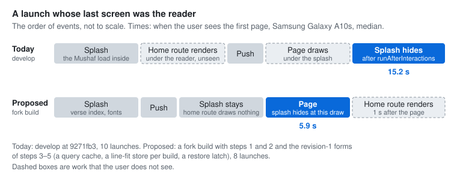

# RFC-023: A cheaper Mushaf start-up for every phone

| Field  | Value                                                    |
| ------ | -------------------------------------------------------- |
| Status | Proposed (revision 3, after review)                      |
| Date   | 2026-10-30 (revision 3: 2026-11-01)                      |
| Author | Omar Zarka (Qariah)                                      |

## Summary

At every launch, `DigitalKhattDataService` reads all 83,668 words of the active rewayah and builds them into maps, and the boot waits for that before the splash hides. On a 2 GB Android phone this is the largest single cost of a launch. This RFC proposes five steps, in this order. Each step is its own small code PR with tests, and each one is measured before the next:

1. **The Mushaf load leaves the splash path.** The boot stops waiting for it, and the reader waits for the data itself. It works without the other steps, but it ships in one release with step 2: alone, it moves the words build from the splash onto Home.
2. **Words on demand.** The load reads a verse index, not every word. A getter reads the words it needs, from words databases rebuilt with `id INTEGER PRIMARY KEY`.
3. **The verse index and the page lines at build time.** Both are the same for every rewayah, so a script generates them next to `rewayahDataManifest.ts`, and the layout database leaves the bundle.
4. **Line fits across launches**, under a key that changes with every bundle (an OTA update too) and with a format constant.
5. **One restore state machine** in the root layout. Every reader surface reports its first content.

No new setting, no new dependency, and no change to a public method of the data service.

### What changed in revision 3

The second review of this RFC (#481) asked for these changes. All of them are in:

- A failed chunk read no longer returns `''` and reads again on the next call. The first error marks the store failed, the rewayah's load state becomes `'error'`, and its copy goes through the delete and re-import path (step 2).
- Step 1 has two more early readers: the home-screen widget and the Live Activity. Both re-run on `subscribeCacheChanges`.
- Steps 1 and 2 ship in the same release.
- The layout database leaves the bundle after step 3, and the verse index is 6,236 word counts.
- The fork's memory and frame numbers are context only. Each code PR brings its own numbers on `develop`. The memory growth on `develop` has its own issue: #482.

One correction to revision 2: of the three page lookups in the verse sheet, only the player's Repeat runs before the data is ready (step 1).

### What changed in revision 2

The review of this RFC (#481) asked for these changes. All of them are in:

- A first step that only moves the load off the splash, measured on `develop` (step 1).
- The words databases are rebuilt with `id INTEGER PRIMARY KEY`, rows in id order. The "no bundled file change" rule is gone (step 2).
- A plan for `RewayahVerseUnitsService`: a streaming read for its build, outside the chunk cache (step 2).
- `WordStore` in its own module, and the connection, reset, error and side-rewayah rules written down (step 2).
- The MMKV query cache is replaced by tables generated at build time (step 3).
- The line-fit store is keyed on the update id and a `LINE_FIT_FORMAT` constant (step 4).
- One restore state machine with `onFirstContent` on every surface, and a defined offline path (step 5).
- A `develop` baseline on the same phone, 10 launches or more (min, median, p90), a second phone, a first launch after install, a non-Hafs rewayah, memory after reading, and the chunk-read cost at page turns.

One new finding changed step 2 more than the review did: on the A10s the chunk read itself cost 119–151 ms, also with the index seek. Most of that is the conversion of 2,048 rows to JS objects. Step 2 now reads one joined string: 7–11 ms with a warm page cache, 8–54 ms in a session on the A10s.

A second finding changed step 1. With the load off the splash, a bookmark or a note opened during the load goes to page 1, or the tap does not respond for seconds. The fork had the first defect after its own version of step 1. Step 1 now opens the reader at once and resolves the page there.

## Motivation

### How the numbers were measured

- **Phones:** a Samsung Galaxy A10s (Android 10, 2 GB RAM, 32-bit `armeabi-v7a`) and a Google Pixel 3 (Android 12, 4 GB RAM).
- **Builds:** release builds, no telemetry keys, `armeabi-v7a`. Each app was compiled the same way before a run (three launches, then `cmd package compile -m speed-profile -f`), and no test driver ran on the phone during a timed launch.
- **`develop`** is `9271fb3` with lab-only log lines (`[BOOT] <name>`): the splash hide call, the data service's ready point, the reader page's first `onReady`. The times are from the `Start proc` line of the process.
- **The proposal** was measured in the fork that runs this code (Expo SDK 57, React Native 0.86; `develop` is on SDK 58 and RN 0.88). The Mushaf files named here are the same in both. The fork numbers have the same lab log lines.
- **A restore launch** is a cold launch whose last screen was the reader, at the start of Al-Baqarah (page 2). A cold launch to Home is a cold launch whose last screen was Home.

### `develop` today

Median (min–p90) in seconds from the process start; n is the number of launches.

| `develop`, release build | Samsung Galaxy A10s | Pixel 3 |
| --- | --- | --- |
| Cold launch to Home: the splash hides | 13.95 (13.88–14.05), n=10 | 4.29 (4.28–4.30), n=10 |
| — of which the Mushaf data is ready (inside the splash) | 11.36 | 3.53 |
| Restore launch, Hafs: the page draws (under the splash) | 14.94 (14.49–15.67), n=10 | 4.56 (4.54–4.62), n=10 |
| Restore launch, Hafs: the splash hides, so the user sees the page | 15.22 (14.59–15.80) | 5.41 (5.35–5.49) |
| Restore launch, Warsh: the page draws / the splash hides | 15.38 / 15.79, n=5 | 4.54 / 5.06, n=10 |
| First launch after an install: the splash hides | 17.00 (16.80–20.73), n=3 | 5.76 (5.68–5.79), n=3 |
| Memory (PSS) with the reader open, then after 40 page turns | 417 MB → 713 MB | 706 MB → 800 MB |
| Janky frames over the 40 page turns (`gfxinfo`) | 96% (p90 57 ms) | 11% (p90 32 ms) |

The growth over 40 page turns on `develop` (417 MB to 713 MB on the A10s) is its own issue, #482. This RFC does not claim to fix it.

On both phones the restored page draws before the splash hides: the splash waits for `runAfterInteractions` after the push (0.3 s on the A10s, 0.85 s on the Pixel 3). We did not see an empty reader frame, but the user waits for the splash after the page is ready.


### 1. The load builds every word

`loadMainSnapshot` (`services/mushaf/DigitalKhattDataService.ts:1194`) calls `readWordRows` (`:615`), which runs `SELECT id, text, location FROM words`, and then `buildWordsData` (`:517`). That builds 83,668 rows into `wordsById`, `wordInfoById` and `verseWords`. The SQLite read runs on a native thread; then the JS thread converts the rows and builds the maps in one piece. No other JS work runs in that time.

The boot waits for this load. `services/AppInitializer.ts:285` registers "Mushaf Preload" as non-critical, but `initialize()` awaits the non-critical services too (`Promise.allSettled`, `:127`), and `services/appBoot.ts:67-69` awaits `appInitializer.initialize()` ("This blocks splash screen"). A user who only listens pays this cost at every launch. `MushafPreloadService.ts:169-174` also loads the Skia fonts after the data, but the fonts need none of the data.

### 2. Two small queries are slow during a launch

With words on demand, the load runs two queries: the verse index (one `GROUP BY`) and the page lines (`readLayoutRows`, `:649`). On a desktop they take 17 ms and 5 ms. On the A10s, during a launch, they took 2.3 s together, because each `await` resumes only after the other JS work of the launch. Their results are the same for every rewayah: the verse index is identical in all 8 words databases, and all 8 rewayat share one layout database.

### 3. The first page builds each justified line twice

`components/mushaf/skia/SkiaLine.tsx:241-274` builds a justified line, measures it, and builds it again with the fit. `components/mushaf/skia/justifiedSpace.ts:114-132` keeps the fit for the session only. So the first page after each launch builds every justified line twice.

### 4. A restore launch draws the home route first

When the last screen was the reader, `app/_layout.tsx:398-429` pushes `/mushaf` over the home route. The home route renders and mounts first, under the reader, where nobody sees it: on the A10s it rendered 1.6 s before the push. After the push, the splash hides through `runAfterInteractions` (`:422`), not when the page draws. On both phones the page drew first, and the splash hid 0.3–0.85 s later (table above). On a phone where the page is slower than that wait, the user sees an empty reader frame instead, because the page has opacity 0 until its `onReady` (`components/mushaf/main.tsx:252`, `:298`, `:307`).

## Decision

### Step 1: the Mushaf load leaves the splash path

- "Mushaf Preload" is not awaited by `initialize()`: it starts after the splash hides. (The other non-critical services keep their current order.)
- `app/mushaf.tsx` reads `digitalKhattDataService.initialized` once at mount (`:69`). That is safe today only because the boot waits. With step 1 the reader subscribes to the load (`useSyncExternalStore`, as the preload state already does at `:147`), shows its loading view until the data is ready, and resolves `surah`, `ayah` and `anchor` params after it. With no `page` param, it takes the page of the verse (`getPageForVerse`), not the start page of the surah.
- **A saved verse opens the reader at once.** Today `savedVerseOpenParams` (`services/verse-annotations/openSavedVerse.ts`, used by Bookmarks and Notes) reads the data before it navigates. With step 1, a tap during the load fails in one of two ways:
  - A row that needs no rewayah switch opens page 1. `getPageForVerse` returns nothing, the `|| 1` fallback sends `page=1`, and the reader takes it as a valid page.
  - A row that needs a rewayah switch does not respond. `restoreSavedRewayah` awaits `switchRewayah()`, which before the first load ends only when the whole load ends. On the A10s the screen does not change for several seconds after the tap.

  So the list sends the saved verse (`surah`, `ayah`, `anchor`) and its rewayah, with no page, and does not await the data. The reader shows its loading view at once. When the data is ready, it restores the rewayah and goes to the page of the verse.
- **The player's Repeat opens the reader at once.** The player's verse list (`components/player/v2/PlayerContent/QuranView/VerseItem.tsx`) opens `VerseActionsSheet` outside the reader, so it can open before the data is ready. `handlePlayerRepeat` (`components/sheets/VerseActionsSheet.tsx:649`) looks the page up at the tap (`:673`). Before the data is ready it then opens the reader at an old page or at page 1, with the player options on that page. So Repeat sends the verse and a `playerOptions` param, with no page. When the data is ready, the reader opens the page of the verse, sets `currentPage`, and shows `mushaf-player-options` once. The two lookups in `startPlaybackForSelection` (`:523`, `:542`) do not change: only a sheet opened from the reader runs them, and the reader is behind its load gate.
- **Two more early readers re-run when the data is ready.** `collectSnapshotInput` (`services/widgets/collectSnapshotInput.ts:30`, `:55`) gives `''` and `null` while the data is not loaded, and `startWidgetSync` (`services/widgets/syncWidgets.ts:244`) does not subscribe to the data service. So the first snapshot after a launch leaves the Continue Reading widget with no verse text until another store changes. `startWidgetSync` subscribes to `subscribeCacheChanges`, and the snapshot diff still writes only what changed. The Live Activity's ayah ticker (`services/widgets/live-activity/syncLiveActivity.ts:177`; its mode is `'off'` on `develop`) publishes again on the same signal. A new snapshot alone is not enough there, because `publish` skips the same ayah number (`ayahTicker.ts:55`).
- The `/quran/{s}/{a}` link already holds its redirect until the page is known (`app/quran/[surah].tsx`). It does not change.
- On a restore launch the reader starts the load at once, so it does not wait for the splash to hide.
- **One release with step 2.** Step 1 alone moves the 6.3 s words build from the splash onto Home, where taps do not respond. The code PRs stay separate, but no release carries step 1 without step 2.

**Result (`develop` + the boot part of step 1; the reader changes are not in this lab build, so it was measured on cold launches to Home only):**

10 cold launches to Home, release builds. "Data ready" is when the words are in memory.

| | A10s: splash hides | A10s: data ready | Pixel 3: splash hides | Pixel 3: data ready |
| --- | --- | --- | --- | --- |
| `develop` | 13.95 | 11.36 (before the splash) | 4.29 | 3.53 (before the splash) |
| `develop` + step 1 | **8.47** (8.38–8.53) | 14.77 (14.23–15.07) | **2.83** (2.81–2.84) | 4.53 |

So step 1 alone moves 5.5 s off the splash on the A10s. It does not remove the work: the JS thread builds the words in one block for 6.3 s after the splash, while the user sees Home. That is why step 2 ships with it. Steps 2–5 remove most of the work.

Fork context, on the A10s with the words on demand: a lab build that held the load for 180 s opened the reader 0.59 s after a Repeat tap, then showed the options on the page of the verse when the data was ready. On a normal launch, the first widget snapshot had no verse text, and a second snapshot, after the data was ready, wrote it to the Continue Reading widget only.

### Step 2: words on demand

**The words databases.** All 8 words databases are rebuilt with `words.id` as the `INTEGER PRIMARY KEY` and the rows in id order. Today no `words` table has an index (`id INTEGER` only), so `WHERE id BETWEEN` scans the table, and the Hafs rows are stored out of id order (the rowid is not the id for 83,663 of 83,668 rows). The rows do not change: the Hafs database is rewritten in id order, and the 7 others come from `scripts/rewayah/build_sibling_rewayah.py`, which copies the Hafs schema; all its validators pass, and a second run writes nothing. Each file gets about 220 KB smaller. The content-addressed copies and `gen-manifest.mjs` make installed apps import the new files. A test checks that a chunk read's query plan is `SEARCH words USING INTEGER PRIMARY KEY` on all 8.

**The load.** It opens the words database, runs the integrity counts, and reads the verse index (6,236 rows: the first and the last word id of each verse; step 3 makes this a generated table). `MushafPreloadService` loads the Skia fonts while the data loads.

**`WordStore`** (`services/mushaf/wordStore.ts`, not in `DigitalKhattDataService.ts`):

- **A getter** reads the 2,048 ids around a word, synchronously, so no caller changes. The read asks for one string, the texts in id order joined by U+001F (no text holds it):

  ```sql
  SELECT group_concat(text, char(31) ORDER BY id) AS texts FROM words WHERE id BETWEEN ? AND ?;
  ```

  On the A10s this takes 7–11 ms. The same 2,048 rows as objects (`getAllSync`) took 119–151 ms, also with the seek, and as raw arrays 71–78 ms. A word's verse and position come from the verse index: in every words database `location` is `surah:ayah:(id − first id of the verse + 1)` (a test checks it on all 8). A word's info object is built on first use.
- **Cache:** the 24 chunks and the 1,024 verses used last.
- **Connection:** the data service owns each `WordStore`, and a `WordStore` owns one open connection to its copy. The existing side-cache rules decide when a store closes: on a rewayah switch the old main store becomes a side store (as the old maps do today), and `trimSideCache()` closes the idle side stores beyond `MAX_IDLE_SIDE_ENTRIES` (1) that no surface retains. A closed store answers nothing. `resetDatabases()` closes every store and waits for each close before it deletes a copy.
- **A failed read** (the read throws, or gives the wrong number of texts) marks the store failed on the first error. A getter cannot report this with `''`: 7 of the 8 words databases have words whose text is empty (81–88 in six of them, 3 in Shu'bah), so a page would draw as valid with words missing. A retry on the next call would also read a broken copy again on every getter of a render. So the store reads no more, and the data service drops it in a microtask, because a getter can run inside a render and this wakes subscribers. The rewayah's load state becomes `'error'`, and for the active rewayah `initialized` becomes false. The store closes and its copy is deleted, under the per-name lock, so the next load imports the bundled asset again. `useRewayahWords` already offers its retry on `'error'`, and the reader shows its load-failed view. The preload stays `'ready'`, so the reader's retry calls `ensureRewayahLoaded(rewayah, {retry: true})`. In the fork on the A10s, a forced failure showed that view, and the retry brought the page back in less than 2 s.
- **Side rewayat** are on demand too: each one is a `WordStore` with its own cache.
- **The verse-units build** (`RewayahVerseUnitsService`) gets a streaming read: `WordStore.readInOrder()` reads the table in id order, 2,048 ids at a time, with the same query, outside the chunk cache. So the build evicts none of the reader's chunks, and each read is 7–11 ms inside the build's slices. Its readiness check becomes "the `WordStore` of that rewayah is open", not "the words are in memory". In the fork, which reads the build through the chunk cache today, a switch to Warsh built its units in 8.3 s on the A10s and 2.4 s on the Pixel 3, in slices; the reader then read its evicted chunks again (3–22 ms each). (Generating the units at build time is the other option; it removes the runtime work but adds a second copy of the data to keep in step.)

**Fork context, not a claim for this step** (SDK 57, RN 0.86; full mode):

| Fork build | A10s | Pixel 3 |
| --- | --- | --- |
| A chunk read (2,048 ids) | 8–54 ms (the first read after the open is the slow one) | 3–5 ms |
| Memory (PSS) with the reader open, then after 40 page turns | 322 MB → 393 MB | 502 MB → 587 MB |
| Janky frames over the 40 page turns | 22% (p90 23 ms) | 5% (p90 24 ms) |
| First launch after an install: the splash hides / data ready | 4.45 / 9.48 (n=3; this fork's low-memory mode starts the load 3 s after the splash) | 2.76 / 4.70 (n=3) |

The fork has more changes than step 2 (for example the line-fit store and the restore order), and the word maps are only about 33 MB of its memory gap against `develop`. So these rows do not measure step 2. The step 2 code PR brings its own numbers on `develop`.

### Step 3: the verse index and the page lines at build time

- A script (a new mode of `gen-manifest.mjs`, or a sibling script) reads the verse index from the words databases and the page lines from the layout database, checks that the verse index is the same in all 8, and writes them as packed integer arrays into a generated module next to `rewayahDataManifest.ts`.
- **The verse index is 6,236 word counts,** in verse order. The largest is 129, so each fits in one byte. The first and the last id of a verse are a running sum, and the verse keys follow from each surah's verse count: in all 8 databases the verses are contiguous and in `surah:ayah` order.
- **The layout database leaves the bundle.** Once the page lines are generated, nothing opens `digital-khatt-15-lines.db`. It stays in the repository as the generator's source, with no `require`, no manifest entry and no device copy, so the same rows do not ship twice. The stale-copy sweep keeps `dk_layout` in its list with no current name, so it deletes the copy that an installed app already has (`selectStaleDbFiles` skips a base it does not know: `services/mushaf/DigitalKhattDataService.ts:225-226`).
- The manifest test recomputes both from the database files and fails when the module is stale, as it does for the hashes.
- The data service loads the module on its first Mushaf use (a lazy `require`), so a user who only listens does not parse it.
- This removes the MMKV cache, its keys and its reset hook. It also helps the first launch after an install or an update, which a cache cannot help.
- Size: 6,236 word counts and 9,046 page lines × 7 numbers, about 0.25 MB as text in the bundle. The layout database (0.24 MB) leaves it, so the bundle stays about the same size.

### Step 4: line fits across launches (`components/mushaf/skia/justifiedSpace.ts`)

- `getLineFit` looks in a persistent store when the session map has no fit; `setLineFit` writes to both. Two lines change in `justifiedSpace.ts`.
- The store is a separate MMKV instance. Its name has `LINE_FIT_FORMAT` (a constant that changes with the fit pass, `JustificationService` or a font) and the update id (`Updates.updateId`; with updates off, the build version). So an OTA that changes the shaping or a font starts with an empty store, and a store from another bundle is deleted.
- A value that is not a finite, positive fit is never stored and never served.

### Step 5: one restore state machine

- The root layout owns one restore state for the launch: `none`, `pushing`, `waitingForContent`, `shown`, `ended`. It reads `mushafSessionStore.getLastScreenWasMushaf()` once.
- Every reader surface takes an `onFirstContent` prop and calls it once: `DKPageView` (also inside `DKSpreadView`), `ContinuousMushafView`, `ContinuousListView`, `ReadingPageView` and `QCFPage`.
- **The splash** hides at the first content, with a 4 s deadline from the push for a surface that never reports.
- **Offline Mushaf 1440:** `QCFPage` already calls `onReady` on a page-font load error (`components/mushaf/qcf/QCFPage.tsx:710`), so `onFirstContent` fires at the error and the reader shows its error state. A download that neither ends nor fails is caught by the 4 s deadline.
- **The home route** returns an empty `View` while the state is `pushing` or `waitingForContent`, and renders 1 s after `shown`, on a return to Home, or 15 s after the launch (a safety limit).



**Fork context, not a claim for this step (restore launches):** the fork build (steps 1 and 2, and the revision-1 forms of steps 3–5: the query cache, a line-fit store per build, and a restore latch), against `develop`. When the user sees the first page:

| | A10s | Pixel 3 |
| --- | --- | --- |
| `develop`, Hafs | 15.22 (14.59–15.80), n=10 | 5.41 (5.35–5.49), n=10 |
| Fork, Hafs | **5.94** (5.62–7.60), n=8 | **2.82** (2.76–2.86), n=10 |
| `develop`, Warsh | 15.79, n=5 | 5.06, n=10 |
| Fork, Warsh | **6.28**, n=5 | **2.85**, n=5 |
| Cold launch to Home (`develop`) or Listen (fork): the splash hides | 13.95 → **4.04** | 4.29 → **2.65** |

Two of the 10 fork restores on the A10s lost their start line in the phone's log buffer, so n=8. The fork's home screen is not Bayaan's, so the cold-launch row compares the boots, not the screens.

### What does not change

- No public method of `DigitalKhattDataService` changes its signature.
- No new setting or feature flag. Every phone gets every step.

### Delivery

Five code PRs, in the order above, each with its tests and its numbers:

1. **Step 1.** The reader waits for the data at mount and for each param. A bookmark and a note (one in the active rewayah, one in another), a deep link and the player's Repeat, each before the data is ready: the screen changes at the tap, and the reader then shows the page of the verse. The widget writes again when the data is ready. Step 1 and step 2 go out in one release.
2. **Step 2.** The database rebuild, the manifest, and the query-plan test. An `*.alldbs` test compares every getter with the old full build on all 8 words databases: each word's text and info, each verse's words, each verse's page, the surah start pages, page-to-surah, the text of every ayah line, and a side rewayah. A failed and a short chunk read: no second read, the load state is `'error'`, the copy is gone, and a retry imports it again. A word with empty text is no failure. The streaming read and the units build on all 8.
3. **Step 3.** The generated module, its staleness test, the lazy load, and no layout database in the bundle or on the device.
4. **Step 4.** The same key keeps a fit; a new update id or format starts empty; a bad value is never stored.
5. **Step 5.** Each surface reports its first content once; each end of the wait; the deadline and the safety limit.

## Alternatives considered

1. **Pre-drawn page images.** Rejected: each rewayah and layout needs a large download or bundle; the images lose the tajweed colours, the highlights and the text features; and they are a second renderer to keep.
2. **Build the maps on a background thread or a JSI worker.** Rejected: the synchronous getters need the maps on the JS thread, so the 83,668 entries must still cross to it. It also adds a native dependency.
3. **Keep the full build, but read it in chunks and yield between them.** Rejected: the JS thread gets shorter blocks, but the total work and the memory stay, at every launch, also for users who only listen.
4. **Store the built maps.** Rejected: they are about 33 MB on the A10s, and to read them back costs most of the build.
5. **A cache of the verse index and page lines (revision 1).** Replaced by step 3: the tables are constant, so a cache adds keys and a reset hook and does not help a first launch.
6. **Raw row arrays for a chunk** (`executeForRawResultSync`). Measured: 71–78 ms on the A10s, against 7–11 ms for the joined string.
7. **Precompute the line fits at build time.** Rejected: a fit depends on the font size and the page width of the device.
8. **A failed chunk read that returns `''` and reads again on the next call (revision 2).** Replaced: `''` is a real word text, and a broken copy would read again on every getter of a render.

## Consequences

- **Positive:**
  - Every phone does less work at every launch, and the word maps (about 33 MB on the A10s) leave memory. Each code PR claims its own numbers on `develop`; the fork's numbers above are context only.
  - A user who only listens pays almost nothing for the Mushaf at launch.
  - A restore launch shows the page with no empty reader frame.
- **Neutral:**
  - The public API of the data service does not change. The words databases change their schema, not their rows.
  - The generated tables replace the layout database in the bundle, at about the same size.
- **Negative / risks:**
  - A wrong word on a page is a severe defect. The all-databases test compares every getter with the old build, and it must stay in CI.
  - The data facts of step 2 become a contract of the bundled databases: ids 1..n with no gaps, one id range for each verse, `location` derivable from the id, no NULLs, no U+001F in a text, `id` as the integer primary key. A new words database must keep them; the tests find a break.
  - The words database connection stays open while the app runs (one for each words database in use).
  - A chunk read still runs on the JS thread at a page turn into a new chunk (about every 15 pages): 8–54 ms on the A10s, the first read after the open being the slow one.
  - On a restore launch the splash stays until the first content. A user who goes back at once sees an empty home screen for about 1 s while it renders.

## How we'll know it worked

- The all-databases getter test passes in CI on all 8 words databases.
- On a 2 GB Android phone, release build, 10 launches or more each:
  - after step 1, a cold launch to Home hides the splash sooner than `develop` by about the load time;
  - after step 1, a bookmark tapped during the load opens the reader at once, and the reader then shows the page of the bookmarked verse;
  - after step 1, the Continue Reading widget has its verse text with no change to another store;
  - after step 2, the words are ready less than 3 s after the load starts, and a chunk read with a warm page cache takes less than one frame (16 ms);
  - after step 5, a restore launch shows the first page with no empty reader frame, and sooner than `develop`.

## Open questions

1. **The 1 s delay** before the home route renders after the reader's first content. Shorter gives a full home screen sooner after a quick back gesture; longer keeps the next pages' builds free of competing work.
2. **The 15 s safety limit and the 4 s splash deadline.** Both only catch a reader that never reports. They need no change on a phone that works correctly.
3. **The generated tables' format.** Packed numbers in a TS module (parsed with the bundle, on first use) or a binary asset read at load. The first is simpler; the second keeps the bundle smaller.
